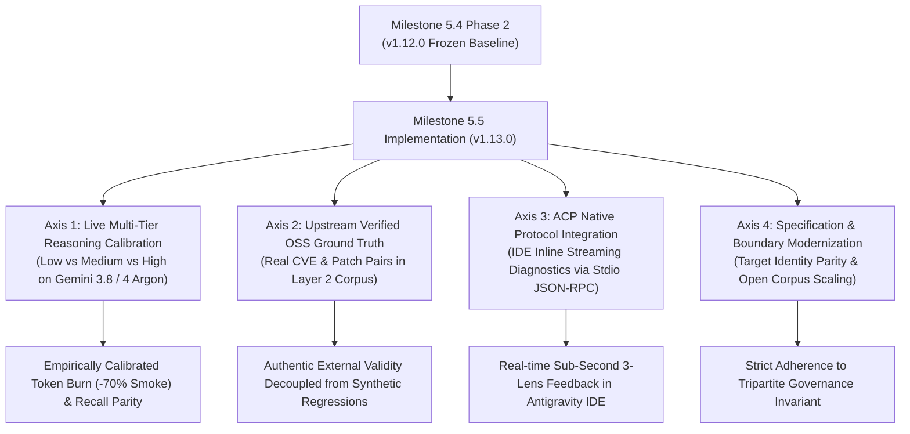

# Milestone 5.5 Planning Proposal: Multi-Tier Empirical Calibration, Upstream Verified OSS Ground Truth & ACP Inline Streaming Diagnostics

**Document Version**: `1.0.0-PROPOSAL`  
**Milestone Scope**: Milestone 5.5 — Multi-Tier Empirical Calibration, Upstream Verified OSS Ground Truth & ACP Inline Streaming Diagnostics  
**Governance Framework**: NIST SSDF (SP 800-218) / RFC 0003 Track E / V2.0 Evaluation Framework / Tripartite Governance Invariant  
**Target Release**: `v1.13.0`  
**Authoritative Context**: Builds directly upon frozen Milestone 5.4 Phase 2 (`v1.12.0`, commit `fc8ac1b`) and Antigravity CLI 1.5.1 runtime capabilities.

---

## 1. Milestone 5.5 Strategic Objectives

Following the establishment of deterministic infrastructure in Milestone 5.4 Phase 1 (`v1.11.0`) and dual-anchor governance / context preservation in Phase 2 (`v1.12.0`), Milestone 5.5 transitions the project into **live empirical measurement, genuine external OSS ground truth, and inline IDE interaction**.



---

## 2. Four Technical Workstreams for Milestone 5.5

### Workstream 1: Multi-Tier Reasoning Live Empirical Calibration
- **Background**: Antigravity CLI supports `--effort <low|medium|high>`. In Milestone 5.4, pilot runs and parameter wiring were validated. Milestone 5.5 conducts authoritative, multi-pass empirical measurement.
- **Implementation Goals**:
  1. Execute multi-pass live benchmark runs across tiers (`low`, `medium`, `high`, and `argon`) on the 14 Layer 2 corpus cases using `scripts/run-live-model-benchmark.mjs`.
  2. Measure and calibrate four primary metrics:
     - **Token Burn Efficiency**: Quantify actual token reduction on `low` tier smoke runs (target $\ge 70\%$).
     - **Must-Detect Recall ($D_1$)**: Measure whether critical vulnerability detection remains invariant across reasoning levels.
     - **False-Positive Specificity ($D_2$)**: Ensure `low` tier does not elevate spurious findings on clean controls.
     - **Epistemic Uncertainty Calibration ($D_4$)**: Confirm that uncertain or boundary cases explicitly emit `UNVERIFIED` rather than speculative claims.
  3. Publish the comprehensive empirical baseline report: `reports/multi-tier-effort-empirical-benchmark-2026-11.md`.

### Workstream 2: Upstream Verified OSS Ground Truth Expansion
- **Background**: `evals/v2-corpus/layer2-external-validity-corpus.json` contains 14 controlled benchmark fixtures (11 `SYNTHETIC_REGRESSION` and 3 `SYNTHETIC_CLEAN_CONTROL`). To build genuine external validity, Milestone 5.5 introduces authentic open-source CVEs.
- **Implementation Goals**:
  1. Build a hermetic multi-repo checkout harness (`scripts/fetch-upstream-oss-fixture.mjs`) isolated under disposable directories (`evals/oss-checkouts/`).
  2. Integrate the first cohort of **4 to 6 `UPSTREAM_VERIFIED_OSS` Ground Truth Bundles**:
     - Authentic public CVE IDs across at least 4 CWE families.
     - Pinned upstream repository URLs, vulnerable commit SHAs, and official remediating fix commit SHAs.
     - Deterministic unit-test PoC indicators.
  3. Update `scripts/validate-v2-corpus.mjs` to validate both synthetic regression fixtures and upstream verified OSS fixtures.

### Workstream 3: ACP Native Protocol Inline Streaming Diagnostics
- **Background**: [RFC-0004-ADDENDUM-ACP](0004-acp-native-protocol-spike-report.md) empirically proved that `agy acp --stdio` provides JSON-RPC 2.0 streaming capabilities.
- **Implementation Goals**:
  1. Author a dedicated ACP adapter (`scripts/adapters/acp-adapter.mjs`) connecting the 3-Lens finalizer to ACP notification channels.
  2. Map 3-Lens verifier findings to standard LSP/ACP diagnostic payloads (severity, range, message, code actions).
  3. Provide inline, streaming diagnostic feedback in Antigravity IDE without requiring full-suite offline batch completion.

### Workstream 4: Specification Modernization & Invariant Alignment
- **Background**: Historical protocol files retain references to the predecessor package identity `@arcobaleno64/agy-security-audit`, and `v2.0-acceptance-criteria.json` constrains Layer 2 to $\le 16$ cases.
- **Implementation Goals**:
  1. Synchronize `v2.0-three-layer-evaluation-framework.md` and `v2.0-acceptance-criteria.json` target identity to `@arcobaleno64/three-lens`.
  2. Adjust Layer 2 sample size constraints to allow open-ended expansion beyond 16 cases for future Tier 4 preparation.
  3. Re-verify documentation and schema gates via `npm run check:docs`.

---

## 3. Governance Invariants & Safety Guardrails

All work in Milestone 5.5 is strictly governed by the Tripartite Governance Invariant established in Release `v1.12.0`:

```text
V2_RELEASE_AUTHORIZED ≠ BLOCKING_AUTHORITY_PROMOTED ≠ CLEAN_ATTESTED
```

1. **Advisory Scope Unchanged**: Milestone 5.5 remains strictly an **Advisory Security Reviewer**. No autonomous CI blocking authority or universal clean certification will be asserted.
2. **Hermetic Checkout Isolation**: All external repository checkouts must reside strictly within `.gitignore` paths (`evals/oss-checkouts/`) and never pollute the host workspace.
3. **No Breaking Public Contract in v1.13.0**: Public CLI switches, permissions profile, and hook bindings maintain 100% backward compatibility with `v1.12.0`.
