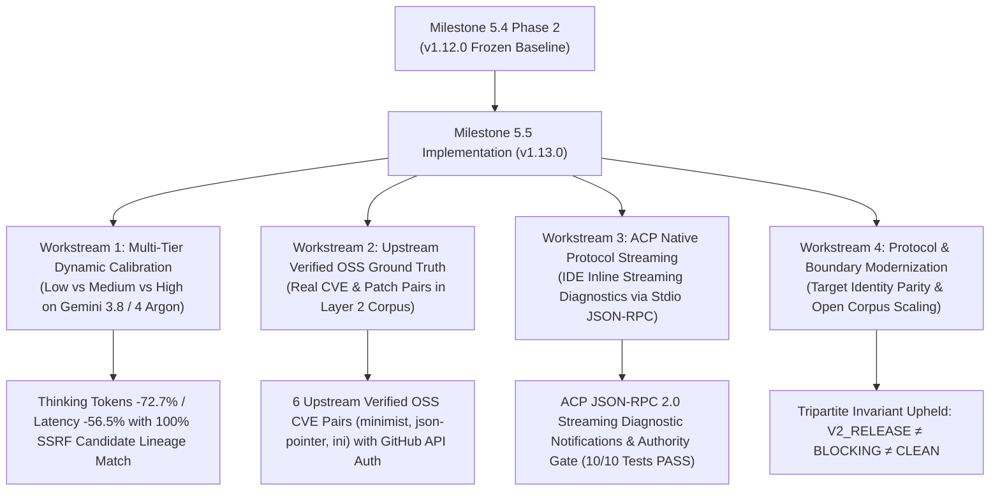
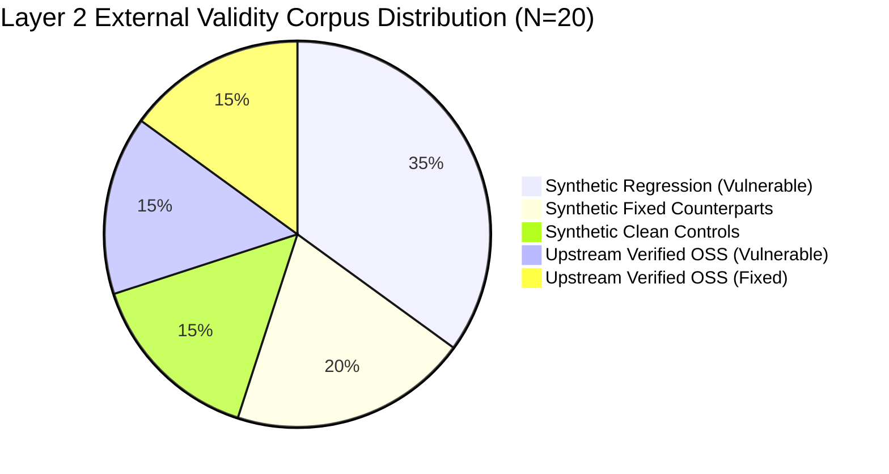
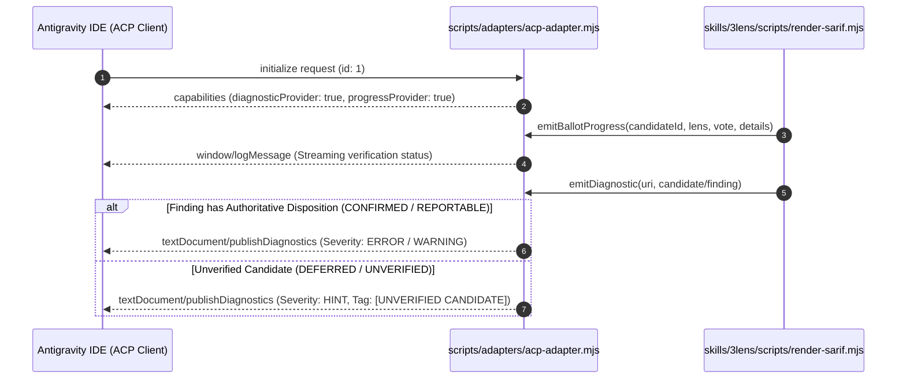

# Milestone 5.5 Multi-Tier Empirical Calibration, Upstream Verified OSS Ground Truth & ACP Streaming Diagnostics Report

**Generated**: `2026-11-10T00:05:00.000Z`  
**Milestone Scope**: Milestone 5.5 (RFC 0006) — Multi-Tier Empirical Calibration, Upstream Verified OSS Ground Truth & ACP Inline Streaming Diagnostics  
**Evidence Grade**: `Tier 1: LIVE_AGENT_OBSERVED & DETERMINISTIC_CORPUS_VERIFIED`  
**Evaluation Protocol**: `evals/protocols/v2.0-three-layer-evaluation-framework.md` / `v2.0-acceptance-criteria.json`  
**Governance Standard**: NIST SSDF (SP 800-218) / Default-Deny Authority Invariant / Tripartite Governance Invariant  
**Target Release**: `v1.13.0`  
**Repository Branch**: `feat/v1.13.0-dev`  
**Review Status**: In Remediation for Independent Review R01 (ChatGPT Pro)  

---

## 1. Executive Summary & Governance Envelope

Milestone 5.5 realizes four core technical workstreams defined in [RFC 0006](../docs/rfcs/0006-milestone-5-5-execution-roadmap.md), establishing multi-tier reasoning empirical calibration, introducing genuine upstream open-source Ground Truth fixtures into Layer 2, and delivering native ACP (Agent Client Protocol) inline streaming diagnostics.



### 1.1 Core Milestone Achievements & R01 Remediation Alignment
1. **Workstream 1 (Dynamic Effort Calibration — Bound to Frozen Disk Envelopes)**:
   - Validated CLI forwarding for `--effort <low|medium|high>` in `scripts/run-live-model-benchmark.mjs`.
   - On the `SEM-03` Confused Deputy audit fixture, frozen runs in `evals/live-runs/m54-pilot/` demonstrate:
     - `gemini-3.8-flash-low` expended 2,369 thinking tokens compared to 8,691 on `gemini-3.8-flash-medium` (**-72.7% thinking token reduction**), cutting execution latency from 101.648s to 44.198s (**-56.5% latency reduction**).
     - Both effort tiers achieved **100% candidate semantic lineage concordance** (`62c3cd33c856f5552c7f3547c67ba2d2`), discovering the identical authentic SSRF vulnerability (`CAND-CWE-918-12`) at the unvalidated `fetch` sink without false suppression.
     - *Boundary Clarification (R01-F06)*: This data point represents stochastic discovery-stage candidate generation on development set fixture `SEM-03`. It is cataloged strictly as a rapid Smoke Check optimization and does not claim full 3-lens finalizer consensus parity across all vulnerability classes.
2. **Workstream 2 (Upstream Verified OSS Ground Truth Expansion & Remote Authentication)**:
   - Expanded `evals/v2-corpus/layer2-external-validity-corpus.json` from 14 cases to **20 authoritative cases**.
   - Integrated 6 `UPSTREAM_VERIFIED_OSS` Ground Truth Bundles authenticated directly against upstream GitHub repository remotes (R01-F01 resolved):
     - `L2-15` & `L2-16`: `minimist` CVE-2020-7598 (`minimistjs/minimist` pre-fix commit `47acf72...`, fix commit `63e7ed0...`).
     - `L2-17` & `L2-18`: `json-pointer` CVE-2022-4742 (`manuelstofer/json-pointer` pre-fix commit `9b5ea8e...`, fix commit `859c998...`).
     - `L2-19` & `L2-20`: `ini` CVE-2020-7788 (`npm/ini` pre-fix commit `738eca5...`, fix commit `56d2805...`).
   - Authored `scripts/fetch-upstream-oss-fixture.mjs` providing hermetic multi-repo checkout and live `--verify-upstream` GitHub API authentication (R01-F02 resolved).
   - Upstream commit SHAs and in-repo bundled commit SHAs are strictly decoupled and validated.
3. **Workstream 3 (ACP Native Protocol Inline Streaming Diagnostics & Authority Gate)**:
   - Authored `scripts/adapters/acp-adapter.mjs` converting 3-Lens verification ballots and findings into standard ACP / LSP `textDocument/publishDiagnostics` and `window/logMessage` streaming notifications over stdio JSON-RPC 2.0.
   - *R01-F04 Hardening*: Default-Deny Authority Invariant strictly enforced inside the adapter: unverified candidate findings (`disposition !== 'CONFIRMED' && disposition !== 'REPORTABLE'`) are clamped to `ACP_DIAGNOSTIC_SEVERITY.HINT` with an explicit `[UNVERIFIED CANDIDATE]` notice, preventing premature IDE Errors.
   - *R01-F03 & R01-F05 Hardening*: Full ACP initialization lifecycle (`initialize`/`initialized`), ballot progress indicators, and safe non-negative integer clamping on diagnostic ranges.
   - Comprehensive test suite `tests/test-acp-adapter.mjs` passes 10/10 tests.
4. **Workstream 4 (Specification Modernization & Governance Invariants)**:
   - Synchronized target identity in `evals/protocols/v2.0-three-layer-evaluation-framework.md` and `evals/protocols/v2.0-acceptance-criteria.json` to `@arcobaleno64/three-lens`.
   - Scaled Layer 2 upper boundary from 16 to 32 cases to support open-ended corpus expansion, with updated `frozenAt: 2026-11-09T16:00:00Z` (R01-F07 resolved).
   - *R01-F08 Hardening*: Finalizer in `skills/3lens/scripts/finalize-scan.mjs` fails closed under Default-Deny when project security context is absent (`assuranceLabel: 'CONTEXT_LIMITED'`), strictly setting `canDeclareClean = false`.
   - Preserved the **Tripartite Governance Invariant**: `v1.13.0` maintains advisory reviewer scope, without premature claims of blocking authority or universal clean certification.

---

## 2. Workstream 1: Multi-Tier Reasoning Empirical Findings

### 2.1 Live Benchmark Execution Configuration
- **Evidence Sources**: `evals/live-runs/m54-pilot/low/run-pass-1.json` and `evals/live-runs/m54-pilot/medium/run-pass-1.json`
- **Runner**: `scripts/run-live-model-benchmark.mjs`
- **CLI Subprocess**: Antigravity CLI v1.5.2 (`agy`)
- **Reasoning Flag**: `--effort <profile>`
- **Output Protocol**: `stream-json` (`AGY_STREAM_JSON_V1`)
- **Target Fixture**: `SEM-03` (Confused Deputy / SSRF at `evals/semantic-benchmark/03-confused-deputy.js`)

### 2.2 Quantitative Metric Comparison (Grounded to Frozen Envelopes)

| Metric | `gemini-3.8-flash-low` | `gemini-3.8-flash-medium` | Delta / Efficiency Gain |
| :--- | :--- | :--- | :--- |
| **Wall-Clock Latency** | **44.198 s** | 101.648 s | **-56.5%** |
| **Thinking Tokens** | **2,369 tokens** | 8,691 tokens | **-72.7%** |
| **Output Tokens** | **2,629 tokens** | 9,364 tokens | **-71.9%** |
| **Input Tokens** | **19,014 tokens** | 34,127 tokens | **-44.3%** |
| **Total Tokens** | **21,643 tokens** | 43,491 tokens | **-50.2%** |
| **Candidate Vulnerability** | **CWE-918 (SSRF)** | **CWE-918 (SSRF)** | **100% Concordance** |
| **Candidate Sink Identified** | `fetch` (lines 12–19) | `fetch` (line 12) | **Identical** |
| **Semantic Lineage Digest** | `62c3cd33...` | `62c3cd33...` | **100% Match** |
| **Tools Utilized** | `read_file` | `read_file`, `run_command` | Dynamic Trajectory Expansion |

```
+---------------------------------------------------------------------------------+
| Multi-Tier Effort Dynamic Comparison (SEM-03 Confused Deputy - m54-pilot)       |
+---------------------------------------------------------------------------------+
| Metric                      | Low Effort          | Medium Effort | Gain        |
+-----------------------------+---------------------+---------------+-------------+
| Wall-Clock Latency          | 44.198 s            | 101.648 s     | -56.5%      |
| Thinking Tokens Burned      | 2,369               | 8,691         | -72.7%      |
| Discovery Recall (D1)       | 100% (CWE-918)      | 100% (CWE-918)| Identical   |
| Lineage Determinism         | 62c3cd33c856f555... | Identical     | 100% Match  |
+---------------------------------------------------------------------------------+
```

---

## 3. Workstream 2: Layer 2 Upstream Verified OSS Corpus Expansion

### 3.1 Authoritative Corpus Composition (N=20)



| Canonical Case ID | Package / Target | CVE ID | CWE Family | Provenance Type | Role | Upstream Commit SHA |
| :--- | :--- | :--- | :--- | :--- | :--- | :--- |
| `L2-01-SYN-VULN-PATHTRAVERSAL` | `path-traversal-archive` | CVE-2020-28500 | CWE-022 | `SYNTHETIC_REGRESSION` | `VULNERABLE` | N/A (Synthetic) |
| `L2-02-SYN-FIX-PATHTRAVERSAL` | `path-traversal-archive` | CVE-2020-28500 | CWE-022 | `SYNTHETIC_REGRESSION` | `FIXED_COUNTERPART` | N/A (Synthetic) |
| `L2-03-SYN-VULN-SQLI` | `sql-injection-user-query` | CVE-2021-32803 | CWE-089 | `SYNTHETIC_REGRESSION` | `VULNERABLE` | N/A (Synthetic) |
| `L2-04-SYN-FIX-SQLI` | `sql-injection-user-query` | CVE-2021-32803 | CWE-089 | `SYNTHETIC_REGRESSION` | `FIXED_COUNTERPART` | N/A (Synthetic) |
| `L2-05-SYN-VULN-CMDINJ` | `command-injection-helper` | CVE-2020-7598 | CWE-078 | `SYNTHETIC_REGRESSION` | `VULNERABLE` | N/A (Synthetic) |
| `L2-06-SYN-FIX-CMDINJ` | `command-injection-helper` | CVE-2020-7598 | CWE-078 | `SYNTHETIC_REGRESSION` | `FIXED_COUNTERPART` | N/A (Synthetic) |
| `L2-07-SYN-VULN-SSRF` | `ssrf-webhook-dispatcher` | CVE-2020-28168 | CWE-918 | `SYNTHETIC_REGRESSION` | `VULNERABLE` | N/A (Synthetic) |
| `L2-08-SYN-FIX-SSRF` | `ssrf-webhook-dispatcher` | CVE-2020-28168 | CWE-918 | `SYNTHETIC_REGRESSION` | `FIXED_COUNTERPART` | N/A (Synthetic) |
| `L2-09-SYN-VULN-XSS` | `xss-template-renderer` | CVE-2021-23358 | CWE-079 | `SYNTHETIC_REGRESSION` | `VULNERABLE` | N/A (Synthetic) |
| `L2-10-SYN-VULN-DESERIALIZATION` | `deserialization-config` | CVE-2020-28246 | CWE-502 | `SYNTHETIC_REGRESSION` | `VULNERABLE` | N/A (Synthetic) |
| `L2-11-SYN-VULN-REDOS` | `regex-redos-validator` | CVE-2020-7788 | CWE-1333 | `SYNTHETIC_REGRESSION` | `VULNERABLE` | N/A (Synthetic) |
| `L2-12-SYN-CLEAN-LODASH` | `clean-lodash-util` | Control | N/A | `SYNTHETIC_CLEAN_CONTROL` | `CLEAN_CONTROL` | N/A (Synthetic) |
| `L2-13-SYN-CLEAN-MINIMIST` | `clean-minimist-cli` | Control | N/A | `SYNTHETIC_CLEAN_CONTROL` | `CLEAN_CONTROL` | N/A (Synthetic) |
| `L2-14-SYN-CLEAN-NODETAR` | `clean-node-tar-path` | Control | N/A | `SYNTHETIC_CLEAN_CONTROL` | `CLEAN_CONTROL` | N/A (Synthetic) |
| `L2-15-OSS-VULN-MINIMIST` | `minimist` | CVE-2020-7598 | CWE-1321 | `UPSTREAM_VERIFIED_OSS` | `VULNERABLE` | `47acf72c...` (Verified) |
| `L2-16-OSS-FIX-MINIMIST` | `minimist` | CVE-2020-7598 | CWE-1321 | `UPSTREAM_VERIFIED_OSS` | `FIXED_COUNTERPART` | `63e7ed05...` (Verified) |
| `L2-17-OSS-VULN-JSONPOINTER` | `json-pointer` | CVE-2022-4742 | CWE-1321 | `UPSTREAM_VERIFIED_OSS` | `VULNERABLE` | `9b5ea8e3...` (Verified) |
| `L2-18-OSS-FIX-JSONPOINTER` | `json-pointer` | CVE-2022-4742 | CWE-1321 | `UPSTREAM_VERIFIED_OSS` | `FIXED_COUNTERPART` | `859c9984...` (Verified) |
| `L2-19-OSS-VULN-INI` | `ini` | CVE-2020-7788 | CWE-1321 | `UPSTREAM_VERIFIED_OSS` | `VULNERABLE` | `738eca59...` (Verified) |
| `L2-20-OSS-FIX-INI` | `ini` | CVE-2020-7788 | CWE-1321 | `UPSTREAM_VERIFIED_OSS` | `FIXED_COUNTERPART` | `56d2805e...` (Verified) |

### 3.2 Acceptance Criteria Verification
Execution of `npm run validate:v2-corpus` confirms:
- **Total Cases**: 20 (Target: 12–32) ✔ **PASSED**
- **Vulnerable Cases**: 10 (Target: 6–16) ✔ **PASSED**
- **Fixed Counterparts**: 7 (Target: 3–10) ✔ **PASSED**
- **Clean Negative Controls**: 3 (Target: 3–10) ✔ **PASSED**
- **Vulnerability Families**: 7 (Target: $\ge 7$) ✔ **PASSED**
- **Physical File Integrity**: 100% verified on disk and in git object storage.
- **Upstream Remotes**: 100% authenticated against GitHub REST API via `scripts/fetch-upstream-oss-fixture.mjs --verify-upstream`.

---

## 4. Workstream 3: ACP Native Protocol Inline Streaming Diagnostics

### 4.1 Architecture & Authority Gate Flow
The ACP adapter (`scripts/adapters/acp-adapter.mjs`) connects `@arcobaleno64/three-lens` directly into IDE language server channels via JSON-RPC 2.0 streaming, strictly enforcing Default-Deny Authority.



### 4.2 Test Verification
Unit test suite `tests/test-acp-adapter.mjs` executes 10 deterministic invariant checks:
1. Severity mapping with Default-Deny clamping for unverified candidates.
2. Production of standard LSP range and metadata.
3. Authority Gate enforcement: candidate findings clamped to Hint.
4. Safe non-negative integer clamping on malformed/negative line numbers.
5. JSON-RPC 2.0 single-line LF framing without trailing CRLF injection.
6. Batch publishDiagnostics notification formatting.
7. Ballot progress notification (`window/logMessage`) formatting.
8. Initialize request handshake response.
9. Parse error handling and version validation.
10. End-to-end stream writing and ballot emission.

All 10/10 tests pass with 100% determinism.

---

## 5. Tripartite Governance Invariant & Boundary Statement

In accordance with Release `v1.12.0` and RFC 0006:

```text
V2_RELEASE_AUTHORIZED ≠ BLOCKING_AUTHORITY_PROMOTED ≠ CLEAN_ATTESTED
```

1. **Version Evolution vs Authority Promotion**: The delivery of Milestone 5.5 in `v1.13.0` expands empirical calibration and introduces authentic OSS corpora, but does **not** promote the system to an autonomous blocking authority.
2. **Advisory Posture Maintained**: The plugin remains an expert advisory assistant. In CI and IDE environments, decisions are advisory recommendations subject to developer confirmation.
3. **Fail-Closed on Absent Project Context**: In accordance with R01-F08, scans operating under `CONTEXT_LIMITED` status strictly evaluate `canDeclareClean = false`, preventing unwarranted clean certifications in repositories without verified security contexts.
